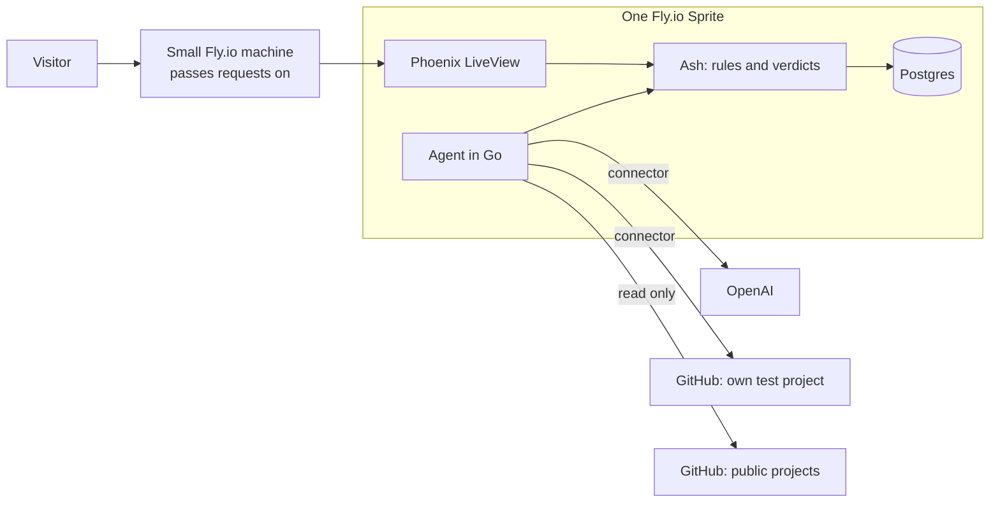

# BuildDoctor

**A 1950s tabloid about your CI, written by agents on one [Fly.io Sprite](https://docs.fly.io/sprites).**

BuildDoctor examines public GitHub Actions pipelines and names what costs time or keeps failing. It prints one newspaper per project while you watch, with headlines, articles and moving press photos. A council of models and code checks what is printed. If a proposed change passes the council, you get a patch.

- **Try it:** https://builddoctor.app
- **Watch the film (109 seconds):** https://youtu.be/_YFuvuOA_SU
- **Built for:** [Fly.io Hacksgiving 2026](https://fly.io/hacksgiving/), started on Monday, November 23, 2026

[](https://youtu.be/_YFuvuOA_SU)

The picture is a still from the film, with the headline, caption and AI illustration of the edition on tokio-rs/tokio.

## What happens when you enter a project

1. **Read.** Go code reads the workflow, the newest good run and recent failures from GitHub, and computes facts.
2. **Suspect.** The Analyst may ask for more facts in up to three rounds, from a closed list that code answers. Then it names problems. Every finding must cite facts and may use only numbers from those facts. Ash checks that.
3. **Check.** The council tries to refute each finding. Code decides; a missing vote is a refusal.
4. **Repair.** If the Analyst proposes no applicable change, code may propose a small one: time limits for jobs whose duration is known, and a rule that a newer push to a pull request ends the older run. If the council passes it, you get a patch and open the pull request yourself.
5. **Print.** While the council votes, the Editor drafts headlines, captions, ads and photo scenes for the findings, and a horoscope on a separate page. Lines about a refused finding are dropped. Code checks numbers, names and plain words; QA and Safety vote on every line. Failures and weaknesses get no joke.
6. **Photograph.** The Photographer makes up to three GIFs with GPT Image 2.6 through the OpenAI connector.
7. **Grade.** With at least three finished runs, code computes a grade from A++ to F and shows every deduction. Duration and waiting for a runner do not count.

Four editions timed on November 25, 2026 took 61 to 77 seconds from the start to the last photo.

Other projects are only read. Their code is never run, and nothing is written to them.

## Who is an agent and who is code

| Role | What it does | Made of |
|---|---|---|
| Reporter | reads GitHub and computes facts | code |
| Analyst | asks for facts and names problems | model |
| QA | tries to refute each statement | a different model from the Analyst's |
| Safety | screens for harmful advice, insults, claims of proof and attempts to steer a model | fixed rules, then a model |
| Engineer | keeps a change within the allowed parts and checks it with actionlint | code |
| Chair | publishes only what passed everything | code |
| Editor | writes headlines, captions, ads, horoscopes and photo scenes | model |
| Photographer | makes the moving press photos | model |

## Measured on our own test project

On [ci-patient](https://github.com/pikespeak/ci-patient), the old and the new workflow take turns, eight runs in total. The first run on each side is only a warm-up. Code compares the rest: accepted, rejected, not proven or failed.

| Trial 7cc0e892 | Before | With the change |
|---|---|---|
| Counted runs | 74 s, 58 s, 70 s | 24 s, 27 s, 26 s |
| Median time from the start of the run to the end of its last job | 70 s | 26 s |

The calculated runner minutes, rounded up for every job, stayed at three per run; we did not read GitHub's billing. This is a small project of our own on GitHub-hosted runners, with three counted runs per side. Your pipeline will behave differently. For other projects, every finding is a suspicion, not proof.

## How it is built



| Folder | Content |
|---|---|
| `agent/` | The agent in Go: facts, process errors, edits, council, editor, photos, measurement |
| `app/` | Phoenix LiveView, Ash and Postgres: rules, verdicts, pages, agent API |
| `demo/` | The test project |
| `media/` | The picture above |
| `ops/` | Deployment in the Sprite, backup, network rules, audit |

The agent gathers facts, proposes and checks changes, and reports through Ash actions. Ash holds the final verdicts and the data; the agent never touches the database directly.

## Safety

- **Connectors:** GitHub (only our test project) and OpenAI (only two paths). The Sprite holds no key for either.
- **Public projects** are read without credentials or with a token that GitHub limits to public data.
- **Network:** rules set from outside allow the Sprite only the hosts that the running app needs (`ops/network.sh`).
- **Limits:** starts per address, one examination per project in 24 hours, and a shared spending stop.
- **Analytics** is off without a key. With one, a visitor must accept it first (`app/assets/js/consent.js`).

## Run the tests

```sh
(cd agent && go vet ./... && go test -race ./...)
(cd app && mix deps.get && mix test)  # needs Postgres on localhost, user and password "postgres"
ops/audit.sh  # known holes and secret patterns
```

On November 25, 2026, 180 Elixir tests passed with 97.53 % line coverage, and the Go package `doctor` had 95.6 % of its statements covered. The commands in `agent/cmd` have no tests. 44 checks in Chrome cover analytics with and without consent (`app/test/browser/analytics.mjs`).

## Run your own

The scripts in `ops/` are written for our Sprite and its paths; take them as an example, not as an installer. The agent needs `APP_URL`, `AGENT_TOKEN`, `GITHUB_GATEWAY`, `REPOSITORY`, `OPENAI_GATEWAY` and `OPENAI_MODEL`. `PICTURES=off` turns the photos off. The app needs `DATABASE_URL`, `SECRET_KEY_BASE`, `PHX_HOST`, `AGENT_TOKEN` and `REQUESTER_KEY`, the last two with at least 32 bytes.

## Limits

We do not read build logs, so we can say which step fails, but often not why. The council was tried with 32 planted errors and 11 good findings that we wrote or chose ourselves: none of the planted errors passed, 7 good findings did. That is no guarantee. The editor's lines were not part of that test.

## License

MIT, see [LICENSE](LICENSE). The bundled copy of posthog-js in `app/assets/vendor` has its own license file next to it.
